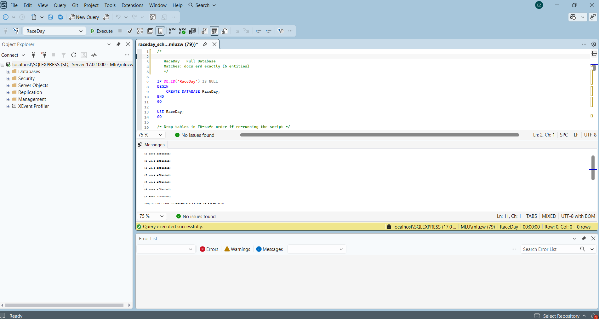

# RaceDay South Africa - Part 3 Final POE Submission

[](https://dotnet.microsoft.com/)
[]()
[](https://azure.microsoft.com/en-us/products/storage/blobs/)
[](https://www.docker.com/)
[-success.svg)]()

Official Part 3 Final Project.

---

## Video Presentation & Demo Link
- **Presentation Contents**:
  1. Architecture walkthrough: MVC Web App calling REST API (strictly zero database queries in MVC).
  2. Organiser Interface: Dashboard KPI metrics, Event CRUD with Azure Blob banner image upload, Category management, Enrolments roster with color-coded status badges, and Results entry with finish times.
  3. Participant Interface: Browse upcoming events with multi-criteria filters, Event detail with instant 1-click enrolment, My Enrolments view, My Results displaying finishing position (*e.g. 47th place out of 312 finishers*), and Athlete Profile with Azure Blob photo upload.
  4. Azure Blob Storage integration walkthrough in `RaceDay.Api`.
  5. Docker setup and single-command startup demonstration.

---

## CI/CD Workflow & Green Build Status
Automated continuous integration is configured in `.github/workflows/ci.yml`. On every push to `main`, the workflow validates:
1. Repository structure and required project files.
2. NuGet dependency restoration and `.NET 8.0` build of `RaceDay.sln`.
3. Execution of unit and integration tests in `RaceDay.Tests`.
4. Multi-stage Docker image builds for both `RaceDay.Web` and `RaceDay.Api`.



---

## Single-Command Docker Instructions

### Option A: Run MVC Web Application with Single Docker Run Command
```bash
docker run -d -p 8080:80 \
  -e "RaceDayApi__BaseUrl=[http://host.docker.internal:5000](http://host.docker.internal:5000)" \
  --name raceday-web \
  raceday-web:latest
